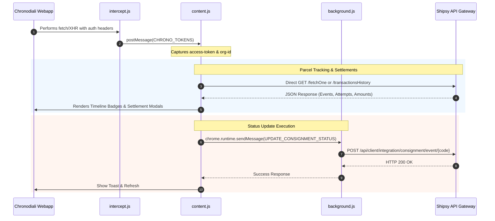

# 🚀 Chrono Enhanced (Mohammedia Hub)

[](https://developer.chrome.com/docs/extensions/mv3/intro/)
[](https://cross.chronodiali.ma)
[](./android)
[]()

**Chrono Enhanced** is an advanced operational suite tailored for the Chronodiali logistics platform (`cross.chronodiali.ma`) and Shipsy backend at the **Mohammedia Hub**. It combines a powerful **Chrome Extension (Manifest V3)** with a dedicated **Android Operations Companion App** to automate repetitive tasks, provide real-time status intelligence, streamline financial reconciliation, accelerate bulk scanning, and automate driver payroll reporting.

---

## 📑 Table of Contents

- [Key Features](#-key-features)
  - [1. Real-Time Parcel Status & Attempt Tracking](#1-real-time-parcel-status--attempt-tracking)
  - [2. Bulk Barcode Import from Excel](#2-bulk-barcode-import-from-excel)
  - [3. Automated Salary & Performance Report Export](#3-automated-salary--performance-report-export)
  - [4. Rider Settlement Amounts Dashboard](#4-rider-settlement-amounts-dashboard)
  - [5. Consignment Direct Status Update Widget](#5-consignment-direct-status-update-widget)
  - [6. High-Speed "Inscan at Hub" Modal Overlay](#6-high-speed-inscan-at-hub-modal-overlay)
  - [7. Verify Completed Trips Synchronization](#7-verify-completed-trips-synchronization)
  - [8. Reconciliation Toast Notifications](#8-reconciliation-toast-notifications)
  - [9. Auto-Configured Default Filters](#9-auto-configured-default-filters)
- [📱 Mobile Companion: Android Operations App](#-mobile-companion-android-operations-app)
- [🏗 Architecture & Technical Stack](#-architecture--technical-stack)
- [📥 Installation & Setup](#-installation--setup)
  - [Chrome Extension Installation](#chrome-extension-installation)
  - [Shipsy API Key Configuration](#shipsy-api-key-configuration)
  - [Android App Setup](#android-app-setup)
- [📝 Complete Changelog](#-complete-changelog)
- [🔒 Permissions & Security](#-permissions--security)

---

## ✨ Key Features

### 1. Real-Time Parcel Status & Attempt Tracking
*Target Pages: Outscan modal, Scan tables (`/ops*`)*

- **Direct Shipsy API Integration**: Replaced slow, fragile iframe DOM scraping with high-speed direct queries to Shipsy's CRM Dashboard API (`/api/CRMDashboard/consignments/fetchOne`).
- **Attempts Counter Badge**: Highlights the exact delivery attempt count (`Attempts: X`) in a dedicated alert badge (`.chrono-ext-attempts-badge`).
- **Inline Mini-Timeline**: Seamlessly injects a color-coded chronological timeline (up to the 3 most recent status logs) directly into the Reference Number cell, preventing React virtual DOM re-render crashes and horizontal scroll displacement.
- **Interactive Event Detail**: Click any timeline event to expand and toggle full event strings, sub-reasons (e.g., absent, client injoignable), and hub origin names.
- **Client-Side Concurrency & Cache**: Controlled queue (up to 4 concurrent requests) with in-memory caching (`statusCache`) to prevent redundant network calls and instant restoration when React repaints rows.

### 2. Bulk Barcode Import from Excel
*Target Pages: Outscan, Inscan at Hub, Set RTO Modals*

- **One-Click Excel / CSV Upload**: Injects a custom **"Import Excel"** button (`.chrono-ext-import-btn`) directly next to the consignment barcode input field.
- **Context-Aware Parsing**:
  - **Outscan**: Scans all columns across the spreadsheet to extract valid tracking numbers.
  - **Inscan / Set RTO**: Specifically targets Column A for standardized reference codes.
- **Smart Filtering**: Automatically starts at row 6 (skipping report headers/metadata) and filters out receipt noise (e.g., `ACCUSE FUTURAMA EXPRESS`, `ACCUSE CHRONODIALI`).
- **Automated Human-Paced Dispatch**: Emulates native React DOM input events and Enter keystrokes at a stable 400ms interval, accompanied by a dynamic progress counter (`Importing (k/N)...`).

### 3. Automated Salary & Performance Report Export
*Target Pages: Trip Manager (`/ops/retail/trip-manager`)*

- **Trip Manager Toolbar Integration**: Injects an Ant Design styled **"📊 Export Salary"** button into the main operational action bar.
- **Dual-Mode Selector Modal**:
  - 📅 **Par Mois**: Select any target month and year for full monthly driver payroll aggregation.
  - 📆 **Par Jour**: Select any specific date for daily operational audit and shift performance.
- **Automated Data Harvesting**:
  - Fetches all hub trips within the selected period.
  - Iterates through trip task summaries (`getTripTaskSummary`) with automated retry logic to gather granular delivery outcomes (Delivered, Undelivered, Out for Delivery, Rescheduled).
  - Canonical rider name normalizer (`getCanonicalRiderName`) eliminates duplicate entries caused by inconsistent spelling or alias prefixes.
- **Template-Based Excel Generation**: Employs `xlsx-populate` to populate the official hub template (`template/calcul-salaire-chrono-template.xlsx`), computing driver commission formulas, totals, and metrics into a formatted `.xlsx` report ready for accounting.

### 4. Rider Settlement Amounts Dashboard
*Target Pages: Global Navigation Drawer (`Financial Operations`)*

- **Drawer Menu Integration**: Injects a dedicated **"Rider Settlement Amounts"** item directly under the Financial Operations submenu in the Ant Design navigation drawer.
- **Dedicated Settlement Modal (720px UI)**:
  - **Date Picker**: Inspect settled driver amounts for today or historical dates.
  - **Live Search**: Instant real-time filtering by driver name or rider code.
  - **Driver Summary Table**: Displays driver name, code, total settled parcel count, and net collected amount in **MAD**.
  - **Reconciliation Audit Trail**: Displays the exact employee name who performed the reconciliation (`Reconciled: Employee Name`).
  - **Accordion Parcel Breakdown**: Click any driver row to toggle a sub-table detailing each individual parcel: tracking number (CN), timestamp, reconciled by, and COD collected.
  - **Sticky Totals Footer**: Real-time aggregation of Total Hub Parcels and Total Collected MAD.
  - **Excel Export**: Export the filtered settlement table to Excel with a single click.

### 5. Consignment Direct Status Update Widget
*Target Pages: Consignment Details (`/ops/details/:referenceNumber`)*

- **Floating Status Utility**: Clean, unobtrusive floating widget (`.chrono-status-widget`) docked to the bottom-right of parcel detail pages.
- **Direct Event Injection**: Dispatches status transitions directly to Shipsy's integration endpoint (`/api/client/integration/consignment/event/{eventCode}`) via the background service worker, bypassing CORS and frontend restrictions.
- **Supported Event Transitions**:
  - `reached_at_hub` (Reached at Hub)
  - `delivered` (Delivered)
  - `attempted` (Attempted / Undelivered — dynamically reveals mandatory reason input)
  - `cancel` (Cancelled — dynamically reveals mandatory reason input)
  - `pickup_completed` (Pickup Completed)
  - `reacheddestination` (Reached Destination)
  - `rto_delivered` (RTO Delivered)
  - `rto` (RTO Initiated)
- **Built-in API Key Vault**: Toggleable credential storage (`chrono_shipsy_api_key`) in `localStorage` with password masking.

### 6. High-Speed "Inscan at Hub" Modal Overlay
*Target Pages: Reconciliation (`/ops/reconciliation/*`)*

- **One-Click Inscan Access**: Injects an **"Inscan at Hub"** button adjacent to standard Reconcile/Cancel buttons.
- **Background Preload Architecture**: Preloads the scanning interface in an isolated background container so the scanner launches instantaneously upon click.
- **Layout Bleed-Through Prevention**: Hides extraneous page layout elements, sidebars, and headers when opening, ensuring a laser-focused scanning station.

### 7. Verify Completed Trips Synchronization
*Target Pages: Rider List (`/ops/reconciliation/rider-list`)*

- **Synchronized Tour Verification**: Injects a **"Verify Completed Trips"** button on the rider reconciliation list.
- **Visual Status Badges**: Pre-checks trip task states via API and attaches a distinct `✔` badge (`.chrono-ext-rider-badge`) next to drivers who have successfully finished their runs, without disrupting Ant Design table column widths.

### 8. Reconciliation Toast Notifications
*Target Pages: Reconciliation (`/ops/reconciliation/*`)*

- **Settlement Monitor**: Watches for the platform's native `"Settlement Done!"` DOM notification.
- **Actionable Reminder**: Triggers a prominent, styled toast reminder alerting operators to click the **"Réglé"** confirmation button.

### 9. Auto-Configured Default Filters
*Target Pages: Consignments Search (`/ops/consignments`)*

- Automatically applies optimal operational filters upon navigating to Consignments:
  - **Hub**: Mohammedia
  - **Date Type**: Last Event Time
  - **Date Range**: Last 60 days

---

## 📱 Mobile Companion: Android Operations App

Located in the [`android/`](./android) directory, the **Chrono Mohammedia Android App** provides a native Material 3 mobile interface for floor managers and dispatchers:

- **Kotlin & Jetpack Architecture**: Built with modern MVVM, ViewBinding, Navigation Component, Coroutines, and LiveData.
- **Navigation Drawer**: Quick filtering for *Tous les Livreurs*, *Courses Terminées (✔)*, *Montants à Régler (MAD)*, and *Colis Non Livrés*.
- **Live Settlement Tracking**: Real-time KPI banner displaying the hub's total daily collection in MAD.
- **Bottom Sheet Parcel Detail**: Tap any driver to view delivered and undelivered parcel lists with reasons and direct phone dialer integration (`tel:`).
- **Dual Data Engine**: Seamless toggle between Mohammedia mock demonstration data and live Shipsy REST API feeds.

For complete Android documentation, see [android/README.md](./android/README.md).

---

## 🏗 Architecture & Technical Stack

```
Chrono-Enhanced-Mohammedia/
├── manifest.json              # Chrome Extension Manifest V3 configuration
├── background.js              # Background service worker (CORS bypass & event dispatcher)
├── content.js                 # Core content script (UI injection, observers, API managers)
├── intercept.js               # Injected page script for token & XHR/fetch interception
├── styles.css                 # Custom stylesheet (badges, modals, animations, widgets)
├── xlsx.full.min.js           # SheetJS library for parsing uploaded spreadsheets
├── xlsx-populate.min.js       # Browser-side template-based Excel generation library
├── template/
│   └── calcul-salaire-chrono-template.xlsx  # Official driver salary workbook template
├── icons/
│   └── logo-small.png         # Extension icons (16x16, 48x48, 128x128)
└── android/                   # Native Android companion application
    ├── app/                   # Material 3 Kotlin application module
    ├── gradle/                # Gradle wrapper & version catalogs (Gradle 8.7)
    └── README.md              # Android setup and build instructions
```

### Data Flow Overview



---

## 📥 Installation & Setup

### Chrome Extension Installation

1. **Download / Clone** this repository to your local computer:
   ```bash
   git clone https://github.com/your-repo/Chrono-Enhanced-Mohammedia.git
   ```
2. Open Google Chrome and navigate to:
   ```
   chrome://extensions/
   ```
3. Toggle on **Developer mode** in the top-right corner.
4. Click **Load unpacked** in the top-left corner.
5. Select the root directory: `Chrono-Enhanced-Mohammedia`.
6. The extension is now active on all `https://cross.chronodiali.ma/ops*` pages.

### Shipsy API Key Configuration

To use the **Consignment Status Update Widget**:
1. Open any consignment detail page (`https://cross.chronodiali.ma/ops/details/<CN_CODE>`).
2. Locate the floating **Chrono: Update Status** widget in the bottom-right corner.
3. Click the key icon (**🔑**).
4. Paste your Shipsy Integration API Key and click **Save**.
5. The key is securely saved in your browser's local storage for subsequent status updates.

### Android App Setup

1. Open **Android Studio** (Hedgehog or newer recommended).
2. Select **Open** and choose the `android` folder within this repository.
3. Allow Gradle to sync automatically (Gradle 8.7 wrapper included).
4. Connect an Android device with USB Debugging enabled (or start an emulator).
5. Press **Run (Shift + F10)**.

---

## 📝 Complete Changelog

### v1.0.0 — Full Operations & Settlement Suite
- **Feature (Salary Export)**: Added comprehensive driver payroll export engine on the Trip Manager page (`/ops/retail/trip-manager`). Supports both monthly and daily exports with real-time progress tracking, automatic trip task crawling, and Excel template population via `xlsx-populate`.
- **Feature (Rider Settlements)**: Injected the "Rider Settlement Amounts" dashboard directly into the Financial Operations drawer menu. Includes date selection, driver-level COD totals, detailed parcel breakdowns, and Excel export.
- **Feature (Status Update Widget)**: Added a floating widget on consignment detail pages allowing operators to trigger Shipsy event transitions (`reached_at_hub`, `delivered`, `attempted`, `rto`, etc.) with integrated Shipsy API key management.
- **Feature (Excel Barcode Import)**: Built-in spreadsheet scanner for Outscan, Inscan, and RTO modals. Parses `.xlsx`, `.xls`, and `.csv` files starting from row 6 with automatic non-tracking header exclusion and simulated typing.
- **Feature (Android App)**: Launched native Android companion app (`android/`) with Material 3, Navigation Drawer, driver cards, live settlement amounts, parcel failure analysis, and phone calling.
- **Performance**: Transitioned parcel status tracking from hidden iframes to direct Shipsy CRM API queries (`/api/CRMDashboard/consignments/fetchOne`), reducing load times by over 4x.
- **Feature (Attempt Count Badge)**: Added display of total delivery attempts (`Attempts: X`) on timeline entries.
- **Feature (Interactive Timelines)**: Made timeline event text clickable to toggle full event descriptions, hub locations, and failure reasons.
- **Stability Fix**: Relocated timeline badges directly inside reference number table cells rather than injecting new columns, eliminating React virtual DOM crashes.
- **Stability Fix**: Solved "Loading..." stuck state on React table repaints using client-side cache restoration.
- **UI/UX**: Custom styling for Ant Design modals, widened scan tables, added toast notification banners, and optimized typography for high-density logistics screens.

---

## 🔒 Permissions & Security

| Permission | Scope | Purpose |
| :--- | :--- | :--- |
| `activeTab` | Active Tab | Injects scripts, stylesheets, and custom controls into the active Chronodiali operational tab. |
| `storage` | Extension Storage | Persists user preferences and cached configurations across sessions. |
| `https://cross.chronodiali.ma/*` | Host Permission | Interacts with Chronodiali web application pages, tables, and drawer navigation. |
| `https://projectxeuapi.shipsy.io/*` | Host Permission | Direct communication with Shipsy backend APIs for consignment details, task summaries, and event updates without CORS restrictions. |

---

## 📄 License & Confidentiality

**Internal Tool**: Developed specifically for internal hub operations at Chronodiali / Shipsy Mohammedia. All rights reserved.
