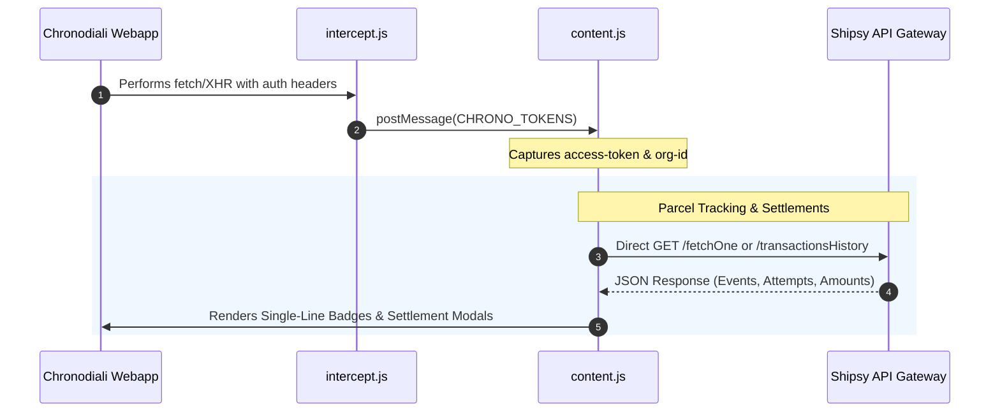

# 🚀 Chrono Enhanced (Mohammedia Hub)

[](https://developer.chrome.com/docs/extensions/mv3/intro/)
[](https://cross.chronodiali.ma)
[](./android)
[]()

**Chrono Enhanced** is an advanced operational suite tailored for the Chronodiali logistics platform (`cross.chronodiali.ma`) and Shipsy backend at the **Mohammedia Hub**. It combines a powerful **Chrome Extension (Manifest V3)** with a dedicated **Android Operations Companion App** to automate repetitive tasks, provide real-time status intelligence, streamline financial reconciliation, accelerate bulk scanning, optimize mobile interfaces, and automate driver payroll reporting.

---

## 📑 Table of Contents

- [Key Features](#-key-features)
  - [1. Real-Time Parcel Status & Attempt Tracking](#1-real-time-parcel-status--attempt-tracking)
  - [2. Universal Bulk Barcode Import from Excel (Inscan, Outscan, Arrival)](#2-universal-bulk-barcode-import-from-excel-inscan-outscan-arrival)
  - [3. Automated Salary & Performance Report Export](#3-automated-salary--performance-report-export)
  - [4. Rider Settlement Amounts Dashboard](#4-rider-settlement-amounts-dashboard)
  - [5. Responsive Consignment & Chosen Trip Details Pages](#5-responsive-consignment--chosen-trip-details-pages)
  - [6. High-Speed "Inscan at Hub" Modal Overlay (Desktop & Mobile)](#6-high-speed-inscan-at-hub-modal-overlay-desktop--mobile)
  - [7. Verify Completed Trips Synchronization](#7-verify-completed-trips-synchronization)
  - [8. Reconciliation Toast Notifications & Quick Actions](#8-reconciliation-toast-notifications--quick-actions)
  - [9. Auto-Configured Default Filters & Mobile Collapsible Bar](#9-auto-configured-default-filters--mobile-collapsible-bar)
- [📱 Mobile Operations App: Hybrid Android Suite](#-mobile-operations-app-hybrid-android-suite)
- [🏗 Architecture & Technical Stack](#-architecture--technical-stack)
- [📥 Installation & Setup](#-installation--setup)
  - [Chrome Extension Installation](#chrome-extension-installation)
  - [Android App Setup & Building](#android-app-setup--building)
- [📝 Complete Changelog](#-complete-changelog)
- [🔒 Permissions & Security](#-permissions--security)

---

## ✨ Key Features

### 1. Real-Time Parcel Status & Attempt Tracking
*Target Pages: Outscan modal, Scan tables (`/ops*`)*

- **Direct Shipsy API Integration**: Replaced slow, fragile iframe DOM scraping with high-speed direct queries to Shipsy's CRM Dashboard API (`/api/CRMDashboard/consignments/fetchOne`).
- **Attempts Counter Badge**: Highlights the exact delivery attempt count (`Attempts: X`) in a dedicated alert badge (`.chrono-ext-attempts-badge`).
- **Inline Single-Line Status**: Compresses status info into one clean line (`.chrono-ext-status-line`), displaying status dot, status label, inline reason, driver/hub metadata, and timestamp.
- **Header Badges**: Placed attempt counters and COD collection badges directly on the reference number line (`.chrono-cn-header`), saving valuable vertical screen real estate.
- **Expandable History (+N)**: Keeps past history collapsed by default with a compact `+N` toggle button to maximize table space.
- **Client-Side Concurrency & Cache**: Controlled queue (up to 4 concurrent requests) with in-memory caching (`statusCache`) to prevent redundant network calls and instant restoration when React repaints rows.

### 2. Universal Bulk Barcode Import from Excel (Inscan, Outscan, Arrival)
*Target Pages: Outscan, Inscan at Hub, Arrival (Run Sheet, Manifest, Bag Arrival), Set RTO Modals*

- **Cross-Platform Excel & CSV Upload**: Custom **"Import Excel"** button (`.chrono-ext-import-btn`) injected beside the consignment scan input on both desktop Chrome and the Android mobile app.
- **Universal Modal & Input Detection**:
  - Automatically identifies all operational modals: Inscan at Hub, Outscan at Hub, Arrival Scan, Run Sheet Arrival, Manifest Arrival, Bag Arrival, and RTO.
  - Automatically binds to the active scan input, supporting French and English placeholders (`CN`, `consignments`, `Scan`, `AWB`, `Bag`, `Run`, `Manifest`, `Arrivée`, `Envoi`).
- **Native Android File Chooser Integration**:
  - Implements Android `WebChromeClient.onShowFileChooser` connected to `StartActivityForResult`.
  - Tapping "Import Excel" on mobile directly opens the native Android system file picker and Google Drive to select `.xlsx`, `.xls`, or `.csv` files.
- **Intelligent Header & Data Parsing**:
  - **Banner Files**: Detects Chronodiali / Futurama export headers and automatically begins reading codes from row 6.
  - **Standard Tables**: Detects standard column headers (`CN`, `Tracking`, `Code Envoi`) and begins from row 2.
  - **Raw Lists**: Parses tracking number lists starting directly at row 1.
  - **Data Type Resilient**: Correctly extracts numeric tracking codes parsed as numbers by Excel (`typeof val === 'number'`).
  - **High-Fidelity Buffer Reading**: Uses `readAsArrayBuffer` + `Uint8Array` + `{ type: 'array' }` to eliminate character encoding corruption on mobile WebViews.
- **Cross-Frame XLSX Sharing**: Automatically exposes the SheetJS library (`window.XLSX`) into child iframes (such as the Inscan modal overlay).
- **Automated Human-Paced Dispatch**: Emulates native React DOM input events (`input`, `change`) and full Enter keypress sequences (`keydown`, `keypress`, `keyup` with keyCode 13) at a stable 450ms interval, accompanied by a dynamic progress counter (`Importing (k/N)...`).

### 3. Automated Salary & Performance Report Export
*Target Pages: Trip Manager (`/ops/retail/trip-manager`)*

- **Trip Manager Toolbar Integration**: Injects an Ant Design styled **"📊 Export Salary"** button into the main operational action bar.
- **Dual-Mode Selector Modal**:
  - 📅 **Par Mois**: Select any target month and year for full monthly driver payroll aggregation.
  - 📆 **Par Jour**: Select any specific date for daily operational audit and shift performance.
- **Automated Data Harvesting**:
  - Fetches all hub trips within the selected period with dynamic Hub ID resolution (`getCurrentHubId()`).
  - Iterates through trip task summaries (`getTripTaskSummary`) with automated retry logic to gather granular delivery outcomes (Delivered, Undelivered, Out for Delivery, Rescheduled).
  - Canonical rider name normalizer (`getCanonicalRiderName`) eliminates duplicate entries caused by inconsistent spelling or alias prefixes.
- **Template-Based Excel Generation**: Employs `xlsx-populate` to populate the official hub template (`template/calcul-salaire-chrono-template.xlsx`), computing driver commission formulas, totals, and metrics into a formatted `.xlsx` report ready for accounting.

### 4. Rider Settlement Amounts Dashboard
*Target Pages: Global Navigation Drawer (`Financial Operations`) & Rider List (`/ops/reconciliation/rider-list`)*

- **Dual Entry Points**:
  - **Drawer Menu Integration**: Injected under the Financial Operations submenu in the Ant Design navigation drawer.
  - **Quick Action Button**: Injects a **"💰 Règlements Livreur"** shortcut directly into the action toolbar on the rider reconciliation page.
- **Dedicated Settlement Modal (920px Desktop / Responsive Mobile UI)**:
  - **Date Picker**: Inspect settled driver amounts for today or historical dates.
  - **Live Search**: Instant real-time filtering by driver name or rider code.
  - **Driver Summary Table**: Displays driver name, code, total settled parcel count, and net collected amount in **MAD**.
  - **Reconciliation Audit Trail**: Displays the exact employee name who performed the reconciliation (`Reconciled: Employee Name`).
  - **Accordion Parcel Breakdown**: Click any driver row to toggle a sub-table detailing each individual parcel: tracking number (CN), timestamp, reconciled by, and COD collected.
  - **Dual Credit Type Accounting**: Processes both `credit_type: 'cod'` and `credit_type: 'settlement'` to guarantee 100% accurate balance totals.
  - **Dynamic Hub Resolution**: Uses `getCurrentHubId()` dynamically instead of hardcoded hub references.
  - **Sticky Totals Footer**: Real-time aggregation of Total Hub Parcels and Total Collected MAD.
  - **Excel Export**: Export the filtered settlement table to Excel with a single click.

### 5. Responsive Consignment & Chosen Trip Details Pages
*Target Pages: Consignment Details (`/ops/details/:id`) & Chosen Trip Details (`/ops/retail/trip/details/:id`)*

- **Consignment Details 2-Column Mobile Layout**: Replaces crushed 4-column Ant Design grids (`.ant-col-6`) with a legible 2-column mobile layout (`width: 50%`), eliminating broken and chopped words ("NON-DOCUMENT") across customer details, delivery info, and packages.
- **Chosen Trip 2-Column KPI Stats Grid**: Transforms squashed summary items into a clean 2-column CSS Grid (`grid-template-columns: repeat(2, 1fr)`) with rounded cards, soft backgrounds, and distinct labels/values.
- **Responsive Sub-Tabs & Action Bars**: Enables horizontal scrolling on sub-tabs with touch-friendly pills, while wrapping search inputs, pagination controls, and action buttons cleanly onto separate rows.
- **In-App Navigation**: Automatically intercepts `target="_blank"` internal URLs and routes them directly within the current WebView via `onCreateWindow`, preventing links from becoming unresponsive or opening blank browser sessions.
- **Clean Interface Purge**: Removed the legacy floating status update widget completely from both mobile and desktop to eliminate screen clutter.

### 6. High-Speed "Inscan at Hub" Modal Overlay (Desktop & Mobile)
*Target Pages: Reconciliation (`/ops/reconciliation/*`)*

- **One-Click Inscan Access**: Injects an **"📥 Inscan at Hub"** button inside the Consignment Balance tab adjacent to Reconcile/Cancel buttons.
- **Segregated Layout Engine**:
  - **Desktop**: Full 1150px widescreen modal layout.
  - **Mobile**: Responsive 98vw card modal with full touch support and dedicated scrolling containers.
- **Background Preload Architecture**: Preloads the scanning interface in an isolated background container so the scanner launches instantaneously upon click.
- **Layout Bleed-Through Prevention**: Hides extraneous page layout elements, sidebars, and headers when opening, ensuring a laser-focused scanning station.

### 7. Verify Completed Trips Synchronization
*Target Pages: Rider List (`/ops/reconciliation/rider-list`)*

- **Synchronized Tour Verification**: Injects a **"Verify Completed Trips"** button on the rider reconciliation list.
- **Visual Status Badges**: Pre-checks trip task states via API and attaches a distinct `✔` badge (`.chrono-ext-rider-badge`) next to drivers who have successfully finished their runs, without disrupting Ant Design table column widths.

### 8. Reconciliation Toast Notifications & Quick Actions
*Target Pages: Reconciliation (`/ops/reconciliation/*`)*

- **Settlement Monitor**: Watches for the platform's native `"Settlement Done!"` DOM notification.
- **Actionable Reminder**: Triggers a prominent, styled toast reminder alerting operators to click the **"Réglé"** confirmation button.
- **Cash Balance Helpers**: Provides automated parcel selection and bulk check helpers for cash reconciliation.

### 9. Auto-Configured Default Filters & Mobile Collapsible Bar
*Target Pages: Consignments Search (`/ops/consignments`)*

- Automatically applies optimal operational filters upon navigating to Consignments:
  - **Hub**: Mohammedia (dynamically matches active user hub)
  - **Date Type**: Last Event Time
  - **Date Range**: Today / Last 60 days
- **Mobile Collapsible Filter Bar**: Replaces oversized filters that consume the entire screen on mobile with a compact **"🔍 Filtres ▼"** toggle button, giving immediate visibility to the consignments table.

---

## 📱 Mobile Operations App: Hybrid Android Suite

Located in the [`android/`](./android) directory, the **Chrono Mohammedia Android App** provides a complete hybrid operational platform for warehouse operations:

- **Portal Selector (`PortalSelectorActivity`)**: Choose between **Chrono Mohammedia Web** and **Marjane Mall Web** upon launch.
- **Full-Fidelity WebView Engine (`ChronoWebActivity`)**:
  - Embeds the full Chronodiali/Shipsy web application.
  - **Automatic AES Token Decryption**: Intercepts session authentication and decrypts Shipsy tokens using native crypto routines, enabling direct backend API calls.
  - **Injected Mobile Responsive CSS (`chrono_mobile.css`)**: 2,500+ lines of scoped CSS transforming desktop-first Ant Design tables, modals, filters, and forms into touch-optimized mobile interfaces.
  - **Injected Script Engine (`chrono_content.js`)**: Runs all extension features natively inside Android (Salary Export, Rider Settlements, Excel Import, Inscan Modal, Status Badges).
  - **Native File Chooser**: Fully implemented `WebChromeClient.onShowFileChooser` allowing file uploads (`.xlsx`, `.xls`, `.csv`) from device storage and Google Drive.
  - **In-App Window Routing**: Implements `WebChromeClient.onCreateWindow` and `setSupportMultipleWindows(true)` to keep internal `target="_blank"` links inside the main app.
  - **Touch & Gesture Enhancements**: Touch-friendly buttons (min 44px), swipeable navigation tabs, and responsive viewport sizing.

---

## 🏗 Architecture & Technical Stack

```
Chrono-Enhanced-Mohammedia/
├── manifest.json              # Chrome Extension Manifest V3 configuration
├── background.js              # Background service worker
├── content.js                 # Core content script (UI injection, observers, API managers)
├── intercept.js               # Injected page script for token & XHR/fetch interception
├── styles.css                 # Custom stylesheet (badges, modals, animations, responsive layout)
├── xlsx.full.min.js           # SheetJS library for parsing uploaded spreadsheets
├── xlsx-populate.min.js       # Browser-side template-based Excel generation library
├── template/
│   └── calcul-salaire-chrono-template.xlsx  # Official driver salary workbook template
├── icons/
│   └── logo-small.png         # Extension icons (16x16, 48x48, 128x128)
└── android/                   # Native Android companion application
    ├── app/                   # Material 3 Kotlin application module
    ├── gradle/                # Gradle wrapper & version catalogs (Gradle 8.7)
    └── README.md              # Android setup and build instructions
```

### Data Flow Overview



---

## 📥 Installation & Setup

### Chrome Extension Installation

1. **Download / Clone** this repository to your local computer:
   ```bash
   git clone https://github.com/your-repo/Chrono-Enhanced-Mohammedia.git
   ```
2. Open Google Chrome and navigate to:
   ```
   chrome://extensions/
   ```
3. Toggle on **Developer mode** in the top-right corner.
4. Click **Load unpacked** in the top-left corner.
5. Select the root directory: `Chrono-Enhanced-Mohammedia`.
6. The extension is now active on all `https://cross.chronodiali.ma/ops*` pages.

### Android App Setup

1. Open **Android Studio** (Hedgehog or newer recommended).
2. Select **Open** and choose the `android` folder within this repository.
3. Allow Gradle to sync automatically (Gradle 8.7 wrapper included).
4. Connect an Android device with USB Debugging enabled (or start an emulator).
5. Press **Run (Shift + F10)**.

---

## 📝 Complete Changelog

### v1.2.3 — Responsive Consignment & Trip Details, In-App Navigation & Cleanup
- **UI/UX (Responsive Consignment Details Page `/ops/details/:id`)**:
  - Converted cramped 4-column cards (`.ant-col-6`) into a clean 2-column mobile layout (`width: 50% !important; max-width: 50% !important;`).
  - Fixed word-splitting and character truncation (e.g., "NON-DOCUMEN T" fixed to "NON-DOCUMENT").
  - Ensured wide fields (addresses, special notes) cleanly expand to full width (`100%`).
- **UI/UX (Responsive Chosen Trip Details `/ops/retail/trip/details/:id`)**:
  - Restructured top trip summary stats (`[class*="itemsWrapper-"]`) into an organized 2-column CSS Grid (`grid-template-columns: repeat(2, 1fr)`).
  - Transformed crowded chips into bordered cards with soft backgrounds and distinct label/value typography.
  - Enabled horizontal scroll on tab bars (`.ant-tabs-nav-wrap`) and cleanly wrapped search inputs and action buttons.
- **Android WebView (`target="_blank"` Navigation Fix)**:
  - Enabled `setSupportMultipleWindows(true)` and implemented `onCreateWindow` in `ChronoWebActivity.kt` using `WebViewTransport`.
  - Added global click delegation stripping `target="_blank"` on internal URLs, keeping navigation smooth inside the app.
- **Cleanup (Purged Legacy Status Update Widget)**:
  - Completely removed the floating status update modal/widget (`.chrono-status-widget`) and its API handlers from both mobile (`chrono_mobile.css`, `chrono_content.js`) and desktop (`styles.css`, `content.js`, `background.js`).

### v1.2.2 — Single-Line Detailed Status & Dropdown Stacking Fix
- **UI/UX (Ultra-Compact Single-Line Status Timeline)**:
  - Compressed the detailed parcel status inside scan modals into **one single horizontal line** (`.chrono-ext-status-line`), displaying status dot, status label, inline reason, driver/hub metadata, and timestamp.
  - Moved attempt badges (`Tentatives: X`) and COD badges (`COD: X MAD`) directly to the top CN reference header line (`.chrono-cn-header`), saving vertical space.
  - Reduced cell height per parcel from ~130px down to ~38px, allowing 6 to 8 scanned items to be visible simultaneously without scrolling.
  - Added an expandable toggle button (`+N`) for older status history entries that remains collapsed by default to maximize table capacity.
- **Fix (Dropdown Stacking Context on Rider List)**:
  - Eliminated the stacking context bug where **"View Rider Transactions here ↗"** and action buttons were rendered on top of open dropdown menus (`Rider ∨`, `Status ∨`).
  - Set baseline `[class*="filterRow-"]` to `z-index: auto` and elevated active/open filter rows to `z-index: 10000+` with CSS `:has()` and click delegation.
  - Set dropdown menus and popovers to `z-index: 30000` and constrained the transaction link to `z-index: 1`.

### v1.2.1 — Enhanced Scan Modal Status Timeline & CameraX Scanner Fix
- **UI/UX (Expanded Scan Modal & Rich Status Timeline)**:
  - Redesigned the Inscan at Hub and scan modals to occupy full viewport width on mobile devices (`width: 98vw; max-width: 98vw; margin: auto`).
  - Restructured table cells so the tracking reference number displays clearly at the top (`.chrono-cn-header > .chrono-cn-code`), while the full status timeline card spans 100% width beneath it.
  - Upgraded status rendering into a full-fidelity timeline card displaying delivery attempt badges (`Tentatives: X`), COD collection badges (`COD: X MAD`), status dots with bold status labels, timestamps, and detailed reason, driver, and hub attributes.
  - Constrained `S.No.` (34px) and `Action` (44px) columns to maximize space for the parcel details.
- **Fix (Android CameraX Scanner Preview & Permission)**:
  - Switched `PreviewView` implementation mode to `COMPATIBLE` to resolve blank/black camera preview screens across various Android devices.
  - Added proactive runtime camera permission handling in both `ScannerActivity` and `ChronoWebActivity`.
  - Added click delegation for in-page input scanner icons (e.g. barcode suffix buttons in Ant Design inputs) to trigger the native CameraX scanner directly.
  - Enhanced barcode injection to accurately target active inputs inside modal dialogs and iframes (`#chrono-inscan-iframe`).

### v1.2.0 — Universal Excel Import & Hybrid Android Operations Platform
- **Feature (Universal Excel Import)**:
  - Enabled one-click barcode import across **Inscan at Hub**, **Outscan at Hub**, and **Arrival** (including Run Sheet Arrival, Manifest Arrival, Bag Arrival) modals.
  - Implemented intelligent header recognition that dynamically detects banner files (starts at row 6), standard headers (starts at row 2), or raw barcode lists (starts at row 1).
  - Added support for numeric tracking numbers stored as Excel numbers (`typeof val === 'number'`).
  - Switched to `readAsArrayBuffer` + `Uint8Array` for universal reliability without binary string encoding corruption.
  - Added full multi-event simulation (`input`, `change`, `keydown`, `keypress`, `keyup` with Enter keycode 13) to trigger React / Ant Design input validation.
  - Added SheetJS cross-frame bridge (`doc.defaultView.XLSX = window.XLSX`) ensuring iframes have instant access to spreadsheet parsing.
- **Feature (Android Native File Chooser)**:
  - Implemented `WebChromeClient.onShowFileChooser` in `ChronoWebActivity` connected to `ActivityResultContracts.StartActivityForResult()`.
  - Tapping "Import Excel" in the Android WebView now opens the native Android system file dialog and Google Drive.
- **Feature (Hybrid Android Suite)**:
  - Added `PortalSelectorActivity` allowing operators to switch between Chrono Mohammedia Web and Marjane Mall Web.
  - Added `ChronoWebActivity` with AES session token decryption, injected mobile responsive CSS (`chrono_mobile.css`), and asset script runner (`chrono_content.js`).
- **UI/UX (Segregated Desktop & Mobile Layouts)**:
  - Scoped mobile styles to prevent altering desktop tables or modal dimensions (restored 1150px widescreen desktop layout and 920px settlement modal).
  - Made Rider Reconciliation fully responsive on mobile: compact header stats, touch-friendly tab switches, and fixed table overlap covering the transactions button.
  - Added **"💰 Règlements Livreur"** action button to `/ops/reconciliation/rider-list`.
  - Added mobile collapsible filter bar (**"🔍 Filtres ▼"**) on Consignments to eliminate full-screen filter takeover.
- **Fix (Settlement Calculations & Multi-Hub)**:
  - Updated settlement aggregation to process both `credit_type: 'cod'` and `credit_type: 'settlement'`.
  - Replaced hardcoded hub IDs with dynamic `getCurrentHubId()` across all API requests.

### v1.0.0 — Full Operations & Settlement Suite
- **Feature (Salary Export)**: Added comprehensive driver payroll export engine on the Trip Manager page (`/ops/retail/trip-manager`). Supports both monthly and daily exports with real-time progress tracking, automatic trip task crawling, and Excel template population via `xlsx-populate`.
- **Feature (Rider Settlements)**: Injected the "Rider Settlement Amounts" dashboard directly into the Financial Operations drawer menu. Includes date selection, driver-level COD totals, detailed parcel breakdowns, and Excel export.
- **Feature (Excel Barcode Import)**: Built-in spreadsheet scanner for Outscan, Inscan, and RTO modals. Parses `.xlsx`, `.xls`, and `.csv` files starting from row 6 with automatic non-tracking header exclusion and simulated typing.
- **Feature (Android App)**: Launched native Android companion app (`android/`) with Material 3, Navigation Drawer, driver cards, live settlement amounts, parcel failure analysis, and phone calling.
- **Performance**: Transitioned parcel status tracking from hidden iframes to direct Shipsy CRM API queries (`/api/CRMDashboard/consignments/fetchOne`), reducing load times by over 4x.
- **Feature (Attempt Count Badge)**: Added display of total delivery attempts (`Attempts: X`) on timeline entries.
- **Feature (Interactive Timelines)**: Made timeline event text clickable to toggle full event descriptions, hub locations, and failure reasons.
- **Stability Fix**: Relocated timeline badges directly inside reference number table cells rather than injecting new columns, eliminating React virtual DOM crashes.
- **Stability Fix**: Solved "Loading..." stuck state on React table repaints using client-side cache restoration.
- **UI/UX**: Custom styling for Ant Design modals, widened scan tables, added toast notification banners, and optimized typography for high-density logistics screens.

---

## 🔒 Permissions & Security

| Permission | Scope | Purpose |
| :--- | :--- | :--- |
| `activeTab` | Active Tab | Injects scripts, stylesheets, and custom controls into the active Chronodiali operational tab. |
| `storage` | Extension Storage | Persists user preferences and cached configurations across sessions. |
| `https://cross.chronodiali.ma/*` | Host Permission | Interacts with Chronodiali web application pages, tables, and drawer navigation. |
| `https://projectxeuapi.shipsy.io/*` | Host Permission | Direct communication with Shipsy backend APIs for consignment details, task summaries, and event updates without CORS restrictions. |

---

## 📄 License & Confidentiality

**Internal Tool**: Developed specifically for internal hub operations at Chronodiali / Shipsy Mohammedia. All rights reserved.
